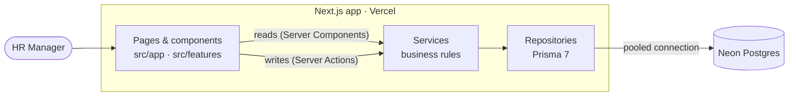

# Architecture

One Next.js 16 app (UI and server) deployed on Vercel, with Postgres on Neon.



## Folder structure

```
src/
  app/                 routes: parse URL params, call a service, render
  features/<feature>/  UI for employees / insights + that feature's Server Actions
  components/          app shell + shadcn/ui primitives
  lib/                 runs on client and server: zod schemas, money & date helpers
  server/              server-only backend
    modules/<feature>/ *.service.ts · *.repository.ts (interface) · *.prisma-repository.ts · *.test.ts
    container.ts       wires Prisma repositories into services
    db.ts              Prisma client (Neon adapter, pooled URL)
prisma/                schema · migrations · deterministic seed
```

## Rules

1. **Services own the business rules** (salary change ⇒ revision, currency defaults from country, validation of references). They depend on repository *interfaces*, never on Prisma or Next.js, so they're unit-tested against in-memory fakes.
2. **Only `*.prisma-repository.ts` touches the database.** Raw SQL is used only for analytics (medians, the FX join), always through parameterised tagged templates.
3. **One zod schema per input.** It validates the form in the browser and the Server Action on the server.
4. **Money is `DECIMAL` plus a currency code**, never a float. Cross-country figures are converted to USD in SQL.

## Request flow

- **Read:** the page reads `searchParams` (filters, page, sort), then calls `services.employees.list(query)`, which goes to the repository and Postgres. The URL is the state, so views are shareable and the back button works.
- **Write:** form → Server Action → `schema.safeParse` → service → repository (single transaction) → `revalidatePath` → fresh render. Domain errors come back as field errors, not exceptions.

## Key decisions

| Decision | Why | Trade-off / revisit when |
|---|---|---|
| **Single Next.js app, no separate Express API** | One persona doing CRUD and aggregates over 10k rows. One deploy, no CORS, no API hop, and no second host that sleeps between demos. *The first draft had an Express API; it was dropped after review as unneeded complexity.* | Add Route Handlers or a separate API when a non-web client (mobile, BI, integrations) appears |
| **Services + repository interfaces** | Rules are testable in milliseconds without a database | A little boilerplate per feature |
| **`DECIMAL(14,2)` + currency per employee; USD via a dated `exchange_rates` table** | Exact money, local *and* cross-country views, reproducible insights | Rates are static; live FX is out of scope |
| **Current salary on `employees` + append-only `salary_revisions`** | Fast reads, full history, both written in one transaction | Kept consistent by a single service method |
| **Server-side offset pagination + `ILIKE` search** | Page numbers and totals, like a spreadsheet; trivial cost at 10k rows | Keyset pagination + `pg_trgm` index past ~100k rows |
| **Prisma 7.10 (stable, not the 8.0 RC) + `@prisma/adapter-neon`** | Typed client and migrations; driver built for serverless | Raw SQL for percentiles |
| **Vitest unit tests with fakes; DB tests opt-in** | Fast, deterministic, no secrets in CI | Fakes can drift; covered by a small integration suite |

## Performance

- Every list is paginated server-side (page size ≤ 100), with indexes on each filter column (see [data model](./03-data-model.md)).
- `count` and the page query run in one transaction, so totals match the rows shown.
- All aggregations happen in Postgres, never in JavaScript.
- Neon **pooled** URL at runtime, **direct** URL for migrations and seed.
- Neon scales to zero, so the first request after idle adds about 0.5 s. That's acceptable for an internal tool.

## Deployment

| | |
|---|---|
| Database | Neon Postgres: `pnpm db:deploy` applies migrations, `pnpm db:seed` loads 10k employees |
| App | Vercel: set `DATABASE_URL` (pooled) and `DIRECT_URL` (direct) |
