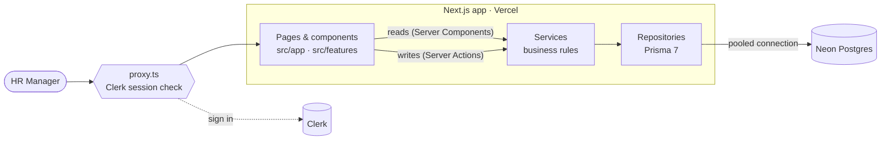

# Architecture

One Next.js 16 app (UI and server) deployed on Vercel, with Postgres on Neon.



## Folder structure

```
src/
  app/                 routes: parse URL params, call a service, render
  features/<feature>/  UI for employees / insights + that feature's Server Actions
  components/          app shell + shadcn/ui primitives
  lib/                 runs on client and server: zod schemas, money & date helpers
  proxy.ts             Clerk: every route except /, /sign-in, /sign-up, /api/health needs a session
  server/              server-only backend
    modules/<feature>/ *.service.ts · *.repository.ts (interface) · *.prisma-repository.ts · *.test.ts
    auth.ts            requireUser() — called first in every Server Action
    container.ts       wires Prisma repositories into services
    db.ts              Prisma client (Neon adapter, pooled URL)
prisma/                schema · migrations · deterministic seed
```

## Rules

1. **Services own the business rules** (salary change ⇒ revision, currency defaults from country, validation of references). They depend on repository *interfaces*, never on Prisma or Next.js, so they're unit-tested against in-memory fakes.
2. **Only `*.prisma-repository.ts` touches the database.** Raw SQL is used only for analytics (medians, the FX join), always through parameterised tagged templates.
3. **One zod schema per input.** It validates the form in the browser and the Server Action on the server.
4. **Money is `DECIMAL` plus a currency code**, never a float. Cross-country figures are converted to USD in SQL.
5. **Auth is checked twice:** `proxy.ts` gates pages, and each Server Action calls `requireUser()` because actions are public POST endpoints.

## Request flow

- **Read:** the page reads `searchParams` (filters, page, sort), then calls `services.employees.list(query)`, which goes to the repository and Postgres. The URL is the state, so views are shareable and the back button works.
- **Write:** form → Server Action → `requireUser()` → `schema.safeParse` → service → repository (single transaction) → `updateTag('employees')` → redirect. Domain errors come back as field errors, not exceptions.
- **Cached reads:** insights and filter options use `'use cache'` + `cacheTag('employees')`, so the dashboard is prerendered and only recomputed after a write. The directory and detail pages stay dynamic (always fresh).

## Key decisions

| Decision | Why | Trade-off / revisit when |
|---|---|---|
| **Single Next.js app, no separate Express API** | One persona doing CRUD and aggregates over 10k rows. One deploy, no CORS, no API hop, and no second host that sleeps between demos. *The first draft had an Express API; it was dropped after review as unneeded complexity.* | Add Route Handlers or a separate API when a non-web client (mobile, BI, integrations) appears |
| **Services + repository interfaces** | Rules are testable in milliseconds without a database | A little boilerplate per feature |
| **`DECIMAL(14,2)` + currency per employee; USD via a dated `exchange_rates` table** | Exact money, local *and* cross-country views, reproducible insights | Rates are static; live FX is out of scope |
| **Current salary on `employees` + append-only `salary_revisions`** | Fast reads, full history, both written in one transaction | Kept consistent by a single service method |
| **Server-side offset pagination + `ILIKE` search** | Page numbers and totals, like a spreadsheet; trivial cost at 10k rows | Keyset pagination + `pg_trgm` index past ~100k rows |
| **Prisma 7.10 (stable, not the 8.0 RC) + `@prisma/adapter-neon`** | Typed client and migrations; driver built for serverless | Raw SQL for percentiles |
| **Clerk for auth, protected-first `proxy.ts`** | Salary data is sensitive, so default-deny. Hosted sign-in/up and user menu out of the box; no passwords stored by us | Single role for now; Organizations + roles for real RBAC |
| **Insights cached with `'use cache'`, expired by `updateTag` on every write** | Aggregations over 10k rows are the heaviest reads and change only on writes | Re-seeding outside the app needs a redeploy (or waits for the 1 h cache life) |
| **Vitest unit tests with fakes; DB tests opt-in** | Fast, deterministic, no secrets in CI | Fakes can drift; covered by a small integration suite |

## Dashboard design

- **Built from a reference mockup.** The layout (KPI cards, annotated histogram, payroll split, countries table, roles table) came from a generated reference image; the prompt is in `docs/04-ai-usage.md`.
- **Every card answers its question in one sentence** (`src/features/insights/takeaways.ts`, unit-tested), so charts are optional reading. "Typical" means median and is defined on the page.
- **One signature mark.** The pay band (lowest → highest, tick for typical, dot for one person) is used for countries, roles and the employee's peer comparison.
- **Cards line up.** Long lists (payroll split, roles) scroll inside a card whose height is set by the card beside it, instead of stretching the row.
- **Motion that never hides content.** Entrance and bar growth are CSS animations on server-rendered content; Framer Motion handles only interactions (the USD/local and department/country switches, list reflow). Everything honours "reduce motion".

## Performance

- Every list is paginated server-side (page size ≤ 100), with indexes on each filter column (see [data model](./03-data-model.md)).
- `count` and the page query run **in parallel**, not in a transaction. Over Neon's WebSocket driver a transaction adds BEGIN/COMMIT round trips; measured 700 ms → 200 ms warm from India to `ap-southeast-1`. A concurrent write can skew the total by one for an instant.
- All aggregations happen in Postgres, never in JavaScript.
- Neon **pooled** URL at runtime, **direct** URL for migrations and seed.
- Dashboard aggregations are cached (see above); measured cold: overview ~800 ms, per-country ~110 ms.
- Deploy Vercel functions in the **same region as Neon** (`sin1` for `ap-southeast-1`) to cut each round trip from ~100 ms to a few ms.
- Neon scales to zero, so the first request after idle adds about 0.5 s. That's acceptable for an internal tool.

## Deployment

| | |
|---|---|
| Database | Neon Postgres: `pnpm db:deploy` applies migrations, `pnpm db:seed` loads 10k employees |
| App | Vercel (region `sin1`): set `DATABASE_URL` (pooled), `DIRECT_URL` (direct) and the Clerk keys |
| Auth | Clerk: development instance now; create a production instance and add the deployed domain before launch |
