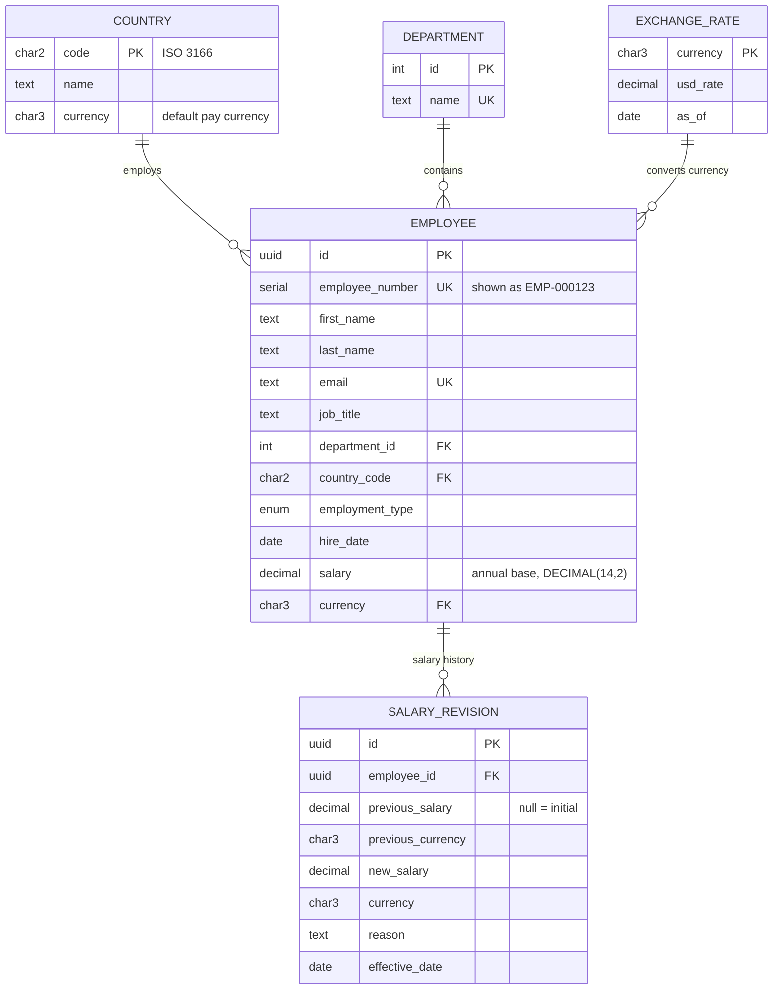

# Data model

Source of truth: [`prisma/schema.prisma`](../prisma/schema.prisma).

## Why it looks like this

- **Current salary on `employees`, history in `salary_revisions`.** Directory and insights read one row per person. Every pay change appends a revision in the same transaction.
- **`currency` per employee, defaulted from the country.** This covers expats and contractors paid in USD or EUR. It's a foreign key to `exchange_rates`, so an employee can't have a currency we can't convert.
- **`DECIMAL(14,2)`, never float.** It's exact and fits annual salaries in IDR or JPY. `CHECK (salary > 0)` backs up the app-level validation.
- **`departments` is a table, `job_title` is text.** Departments are a small governed list; job titles are many and change often.
- **UUID primary key plus a human `employee_number`.** URLs stay opaque, while HR searches by `EMP-000123`.
- **Hard delete (cascades to revisions).** Termination lifecycle is out of scope for v1.

## Indexes

| Index | Serves |
|---|---|
| `email` unique, `employee_number` unique | integrity + exact-match search |
| `(country_code, job_title)` | country filter; "pay by job title in a country" |
| `department_id` | department filter and payroll by department |
| `(last_name, first_name)` | default directory sort |
| `salary_revisions (employee_id, effective_date DESC)` | one employee's salary history |

## Seed

`pnpm db:seed` generates 10,000 employees across 10 countries.

- **Deterministic:** fixed faker seed, so the same data comes out every run.
- **Realistic pay:** `salary = job band (USD) × country pay level × ±15% jitter`, converted to local currency and rounded.
- **Idempotent:** truncates first, inserts in batches of 1,000.
- **Tested:** the generators in `prisma/seed/generators.ts` are pure functions with unit tests.
